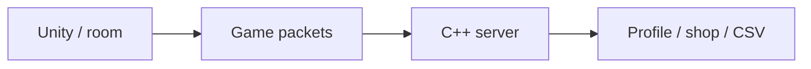

# Slap Squad — Multiplayer Game & Pricing Research

[English](README.md) · [Korean](README.ko.md) · [Japanese](README.ja.md)

**C++ · Winsock · C# · Unity** · チーム開発

[開発事例を見る](https://ysl-ryudo.github.io/ja/work/bnb/) · [Portfolio](https://ysl-ryudo.github.io/ja/)

**2025.03 - 2026.02 · 8名：プログラマー2名、グラフィック6名**

サーバー・ネットワーク連携・ショップとプロフィール実装

BnBServerと連携するチーム制作のUnityマルチプレイヤーゲームです。報酬・ショップの開発をきっかけに、アイテム価格の決め方を研究しました。

## 取り組んだ課題

ルーム、ゲーム内操作、報酬、購入をクライアント・サーバー間で連携させる必要がありました。その実装から、獲得報酬に対してアイテム価格をどう設定するかという疑問が生まれました。

## 担当した実装と設計

パケット・ゲーム連携、ルームリーダー・水風船更新、ショップ・プロフィール処理を担当しました。別のCISC-W研究では仮想プレイヤーの行動を用い、固定価格と需要連動政策を比較しました。

### 実装概要 · 概念フロー

### 開発デモ動画

- [Slap Squad · OFY Studio](https://www.youtube.com/watch?v=1LMGsY_qY_8)
- [Early development demo](https://www.youtube.com/watch?v=MI5NtNU9eP8)

撮影時点のプロジェクトデモです。ゲーム内での担当作業は以下の担当範囲で示します。

## 担当した内容

- ゲーム・サーバーのパケット連携、水風船・ルームリーダー更新、購入UIを担当しました。
- 結果・報酬フローとゲームプレイ連携に参加しました。チーム作品であり、全機能・素材の単独制作を意味しません。
- 本プロジェクトの価格設定問題から発展したCISC-W 2025研究の筆頭著者・ポスター発表者です。

## 貢献の根拠

- [Water balloons / 물풍선 / 水風船](https://github.com/YSL-RyuDo/BNB/commit/95b28f22b7e88ed2c801e6d47a61ca573bcbc8a5)
- [Packets / 패킷 / パケット](https://github.com/YSL-RyuDo/BNB/commit/c4249cc8ee75e2b4b4ace1bdc02c3f5487076a1f)
- [Purchase UI / 구매 UI / 購入UI](https://github.com/YSL-RyuDo/BNB/commit/57cedd2e5c3b0dbbb7ea51b336602cc339630cea)

コミットは記載した変更の根拠であり、貢献率の点数ではありません。外部素材・チームメンバーの貢献は区別します。

## ゲーム開発から研究へ

**CISC-W 2025 ポスター発表。** *Consumption Pattern Analysis of In-Game Pricing Policies Using Convolutional Neural Networks.* 筆頭著者・発表者：Young-Sang Lee。共著者：Ji-Uk Choi、Yun-Ho Kim、Myeong-Jae Lee、Hye-Young Kim。

Slap Squadの試合報酬に対するアイテム価格を検討したことが研究の出発点です。論文中のゲーム名は**SlapSquad**です。仮想プレイヤー400人・30日間のシミュレーションを20回繰り返し、固定価格と基準価格の70～130%に制限した需要連動価格を比較しました。報告されたCNN精度96%は、シミュレーション上の消費パターンを価格政策別に分類した性能であり、最適価格の精度や実測売上増加率ではありません。

[論文PDF](research/CISC-W_2025_paper.pdf)。本ゲームが研究の契機ですが、動的政策の実サーバーへの適用はここでは実証していません。

## 実行・コードの確認

[ProjectVersion.txt](ProjectSettings/ProjectVersion.txt)記載のUnity版で開いてください。パッケージロックとシリアライズ済み素材を維持し、Unityを開く前に対象ブランチを選んでください。

- Unity scene: [Assets/Scenes/LoginScene.unity](Assets/Scenes/LoginScene.unity)

[BnBServer](https://github.com/YSL-RyuDo/BnBServer)

## 開発・検証範囲

過去の実装を整理したプロジェクトです。一部のワールド判断にルームリーダー側の入力を使うため、完全なサーバー権威型とは説明しません。価格研究は仮想プレイヤーによる実験で、分類精度は最適価格や実サービス売上の改善を意味しません。研究上の政策と実際のサーバー政策を同一視しません。

## 実装の確認方法

クライアントとサーバーの本人作成コミットを確認し、論文は別の実験として読めます。サーバーは接続ごとのスレッドとCSVを使用し、一部のワールド判断はルームリーダーの入力を受け取ります。

## 開発から研究・発表へ

CNN価格政策研究を「データで設計するゲーム経済」として発表。その後、研究を補完してCISC-W 2025のポスター発表につなげました。

[2025 I2P-CON](https://www.youtube.com/watch?v=oq_e0TAwvJg)
