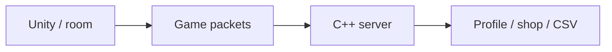

# Slap Squad — Multiplayer Game & Pricing Research

[English](README.md) · [Korean](README.ko.md) · [Japanese](README.ja.md)

**C++ · Winsock · C# · Unity** · 팀 프로젝트

[개발 사례 보기](https://ysl-ryudo.github.io/ko/work/bnb/) · [Portfolio](https://ysl-ryudo.github.io/ko/)

**2025.03 - 2026.02 · 8명 · 프로그래머 2명, 그래픽 6명**

서버·네트워크 연동·상점 및 프로필 구현

BnBServer와 연동하는 팀 Unity 멀티플레이 게임입니다. 보상과 상점을 개발하면서 아이템 가격을 어떤 근거로 정할지 연구하게 되었습니다.

## 해결하려던 문제

방, 게임 내 행동, 보상과 구매를 클라이언트·서버 흐름으로 연결해야 했습니다. 이를 구현하면서 플레이어가 얻는 보상에 비해 아이템 가격을 어떻게 정해야 할지 고민하게 되었습니다.

## 내 구현과 설계

패킷·게임 연동, 룸 리더·물풍선 갱신, 상점·프로필 흐름을 작업했습니다. 별도의 CISC-W 연구에서는 가상 플레이어의 행동을 이용해 고정 가격과 수요 기반 조정 정책을 비교했습니다.

### 구현 개요 · 개념 흐름도

### 개발 시연 영상

- [Slap Squad · OFY Studio](https://www.youtube.com/watch?v=1LMGsY_qY_8)
- [Early development demo](https://www.youtube.com/watch?v=MI5NtNU9eP8)

촬영 당시의 프로젝트 시연입니다. 게임 안에서 제가 맡은 작업은 아래 기여 항목으로 구분합니다.

## 내 기여

- 게임·서버 패킷 연동, 물풍선·룸 리더 갱신, 구매 UI를 작업했습니다.
- 결과·보상 흐름과 게임플레이 연동에 참여했습니다. 팀 프로젝트이며 전체 게임플레이와 에셋을 단독 제작했다는 의미가 아닙니다.
- 이 프로젝트의 가격 결정 문제에서 출발한 CISC-W 2025 가격정책 연구의 제1저자이자 포스터 발표자입니다.

## 기여 근거

- [Water balloons / 물풍선 / 水風船](https://github.com/YSL-RyuDo/BNB/commit/95b28f22b7e88ed2c801e6d47a61ca573bcbc8a5)
- [Packets / 패킷 / パケット](https://github.com/YSL-RyuDo/BNB/commit/c4249cc8ee75e2b4b4ace1bdc02c3f5487076a1f)
- [Purchase UI / 구매 UI / 購入UI](https://github.com/YSL-RyuDo/BNB/commit/57cedd2e5c3b0dbbb7ea51b336602cc339630cea)

커밋은 설명한 변경의 근거이며 기여율 점수가 아닙니다. 외부 에셋과 팀원 작업의 크레딧은 구분합니다.

## 게임 개발에서 연구로

**CISC-W 2025 포스터 발표.** 「CNN 기반 게임 내 가격정책별 소비패턴 분석」. 제1저자·발표자: 이영상. 공동저자: 최지욱, 김윤호, 이명재, 김혜영.

Slap Squad의 경기 보상 대비 아이템 가격을 고민하면서 시작한 연구입니다. 논문에서는 게임명을 **SlapSquad**로 표기합니다. 400명의 가상 플레이어를 30일간 시뮬레이션하고 20회 반복했으며, 고정 가격과 기본 가격의 70~130%로 제한된 수요 기반 가격 조정을 비교했습니다. 보고된 CNN 정확도 96%는 시뮬레이션 소비 패턴의 정책 분류 성능이며, 최적 가격 정확도나 실측 매출 증가율이 아닙니다.

[논문 PDF](research/CISC-W_2025_paper.pdf). 연구의 출발점은 이 게임이지만, 동적 정책의 실제 서버 적용 여부는 여기서 입증하지 않았습니다.

## 실행·코드 확인

[ProjectVersion.txt](ProjectSettings/ProjectVersion.txt)의 Unity 버전으로 프로젝트를 여세요. 패키지 잠금 파일과 직렬화된 에셋을 유지하고, Unity를 열기 전에 문서에서 설명한 브랜치를 선택하세요.

- Unity scene: [Assets/Scenes/LoginScene.unity](Assets/Scenes/LoginScene.unity)

[BnBServer](https://github.com/YSL-RyuDo/BnBServer)

## 개발·검증 범위

과거 구현을 정리한 프로젝트입니다. 일부 월드 결정에 룸 리더 클라이언트 입력이 사용되므로 완전한 서버 권위형 게임으로 소개하지 않습니다. 가격 연구는 가상 플레이어 실험이며, 분류 정확도가 최적 가격이나 실서비스 매출 개선을 뜻하지 않습니다. 연구 정책과 실제 서버 정책이 같다고 가정하지 않습니다.

## 구현을 확인하는 방법

클라이언트와 서버의 작성 커밋을 확인한 뒤 논문을 별도 실험으로 읽을 수 있습니다. 서버는 연결별 스레드와 CSV 저장을 사용하며 일부 월드 결정은 룸 리더 입력을 받습니다.

## 개발에서 연구와 발표로

CNN 가격정책 연구를 「데이터로 설계하는 게임 경제」로 직접 발표했습니다. 교내 발표 이후 연구를 보완해 CISC-W 2025 학회 포스터로 발표했습니다.

[2025 I2P-CON](https://www.youtube.com/watch?v=oq_e0TAwvJg)
