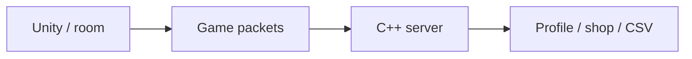

# Slap Squad — Multiplayer Game & Pricing Research

[English](README.md) · [Korean](README.ko.md) · [Japanese](README.ja.md)

**C++ · Winsock · C# · Unity** · Team project

[Explore the case](https://ysl-ryudo.github.io/en/work/bnb/) · [Portfolio](https://ysl-ryudo.github.io/en/)

**Mar 2025 - Feb 2026 · 8 members: 2 programmers, 6 graphics**

Server, network integration & shop/profile systems

A team Unity multiplayer game connected to BnBServer. Building its rewards and shop led me to investigate how in-game item prices should be determined.

## The engineering problem

Rooms, in-game actions, rewards and purchases need a connected client/server flow. Building that loop raised a second question: how should item prices relate to the rewards players earn?

## My implementation

I implemented packet and game integration, room-leader/water-balloon updates, and shop/profile flows. The separate CISC-W study compares fixed and demand-adjusted pricing using simulated player behavior.

### Implementation overview · conceptual flow

### Development videos

- [Slap Squad · OFY Studio](https://www.youtube.com/watch?v=1LMGsY_qY_8)
- [Early development demo](https://www.youtube.com/watch?v=MI5NtNU9eP8)

Recorded project demonstrations; the contribution section below identifies my work within the game.

## My contribution

- Worked on game/server packet integration, water-balloon and room-leader updates, and purchase UI.
- Contributed to result/reward flows and gameplay integration; this is a team project, not a claim of sole authorship of all gameplay or assets.
- First author and poster presenter of the CISC-W 2025 pricing-policy study motivated by this project.

## Contribution evidence

- [Water balloons / 물풍선 / 水風船](https://github.com/YSL-RyuDo/BNB/commit/95b28f22b7e88ed2c801e6d47a61ca573bcbc8a5)
- [Packets / 패킷 / パケット](https://github.com/YSL-RyuDo/BNB/commit/c4249cc8ee75e2b4b4ace1bdc02c3f5487076a1f)
- [Purchase UI / 구매 UI / 購入UI](https://github.com/YSL-RyuDo/BNB/commit/57cedd2e5c3b0dbbb7ea51b336602cc339630cea)

Commits are evidence of the stated changes, not a percentage-of-authorship score. Third-party assets and teammates' work remain separately credited.

## From the game to a research question

**CISC-W 2025 — poster presentation.** *Consumption Pattern Analysis of In-Game Pricing Policies Using Convolutional Neural Networks.* First author and presenter: Young-Sang Lee; coauthors: Ji-Uk Choi, Yun-Ho Kim, Myeong-Jae Lee and Hye-Young Kim.

The question arose while deciding Slap Squad's item prices relative to match rewards. The paper refers to the game as **SlapSquad**. It simulates 400 players over 30 days, repeats the simulation 20 times, and compares fixed prices with demand-based adjustments bounded at 70–130% of the base price. The reported 96% CNN accuracy classifies simulated consumption patterns by pricing policy; it is not an optimal-price accuracy or measured revenue uplift.

[Paper PDF](research/CISC-W_2025_paper.pdf). Research motivation is connected to this game; applying the dynamic policy to the running server has not been established here.

## Open and inspect

Open the project with the Unity version recorded in [ProjectVersion.txt](ProjectSettings/ProjectVersion.txt). Keep its package lock and serialized assets intact. Select the documented branch before opening Unity.

- Unity scene: [Assets/Scenes/LoginScene.unity](Assets/Scenes/LoginScene.unity)

[BnBServer](https://github.com/YSL-RyuDo/BnBServer)

## Development and verification scope

Historical implementation. Some world decisions use room-leader client input, so the game is not described as fully server-authoritative. The pricing study uses simulated players; its classification accuracy does not establish an optimal price or a live-service revenue improvement. Research policies and deployed server policies are not assumed to be identical.

## How to evaluate the work

Follow the authored client and server commits, then read the paper as a separate experiment. The server uses connection threads and CSV-backed data; some world decisions come from the room leader.

## From development to research

Presented the CNN pricing-policy research in “Designing Game Economies with Data.” Subsequently refined the research for the CISC-W 2025 poster presentation.

[2025 I2P-CON](https://www.youtube.com/watch?v=oq_e0TAwvJg)
